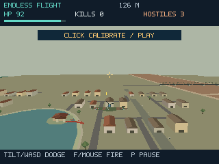

# AERO — FPGA-Powered Motion-Controlled Flight Game

**A motion-controlled 3D aerial combat game that combines an Arduino accelerometer, a C# game engine, and real FPGA graphics rendering.**

Built for **HackRPI 2026**, AERO challenges the usual desktop-game architecture. The player physically tilts an accelerometer to steer an aircraft; a DE10-Standard board runs the game simulation on its ARM processor and renders the scene using an adapted SpinalVoodoo GPU core on its Cyclone V FPGA. Completed frames stream to a browser over Ethernet.

> **Status:** Working FPGA hardware prototype. The accepted sustained active-play test measured **25.22 displayed FPS at 320 × 240**, with live Arduino controls and approximately **60 Hz simulation**. The user accepted this 25 FPS checkpoint. Performance varies with the scene. See [Performance and validation](#performance-and-validation).



*Actual FPGA frame capture. The browser displays pixels generated by the FPGA rather than rendering the 3D scene itself.*

## Project overview

We started with a simple 2D motion-controlled obstacle-dodging game and expanded it into an endless 3D aerial-combat game featuring enemy aircraft, projectiles, a low-poly Hanoi-inspired environment, and a custom graphics pipeline.

| Version | What it demonstrates | Rendering |
| --- | --- | --- |
| **2D Escape Run** | Accelerometer flight controls, obstacle waves, score/combo gameplay | HTML5 Canvas in the browser |
| **3D desktop game** | C# simulation, aerial combat, Hanoi scenery, profiling and repeatable tests | Custom CPU software renderer (Windows) |
| **FPGA flight game** | Live motion input, ARM simulation, FPGA rasterization, Ethernet browser streaming | SpinalVoodoo graphics core on Cyclone V |

The **FPGA version** is the main focus of this repository.

### Highlights

- **Physical controls:** An Arduino UNO R4 WiFi reads a Grove MMA7660 three-axis accelerometer. Calibrated tilt controls horizontal and vertical aircraft movement.
- **True FPGA rendering:** The ARM HPS processes gameplay and prepares triangles; the Cyclone V FPGA performs rasterization, depth testing, texturing and HUD drawing.
- **Playable 3D combat:** Enemy fighter waves, moving projectiles, shooting, health, kills, distance and restart.
- **Hanoi-inspired scenery:** Hoan Kiem Lake, Turtle Tower, Ngoc Son Temple, The Huc Bridge, Long Bien Bridge, and stylized Old Quarter buildings.
- **Browser controls and display:** Actual FPGA frames stream over a WebSocket, with keyboard or touch input sent back on a separate control channel.
- **Reproducibility:** Hardware captures, simulation tests, rendering comparisons, performance evidence and a pinned recovery checkpoint.

## Architecture

```text
      Grove MMA7660 accelerometer
                   |
                  I2C
                   v
           Arduino UNO R4 WiFi
                   |
               USB / libusb
                   v
+------------------------------------------------------+
|                  DE10-Standard                       |
|                                                      |
| ARM Cortex-A9 HPS (embedded Linux)                   |
| +--------------------------------------------------+ |
| | USB sensor reader -> tilt calibration/filtering  | |
| | C# fixed-step game simulation (~60 Hz)           | |
| | Enemy AI, collisions, scenery, camera, HUD        | |
| | Geometry preparation -> native C / Glide bridge  | |
| +-----------------------+--------------------------+ |
|                         | graphics commands          |
|                         v                            |
| Cyclone V FPGA / adapted SpinalVoodoo core            |
| +--------------------------------------------------+ |
| | Triangle rasterization, textures, depth, HUD     | |
| | 320 x 240 RGB565 framebuffer                     | |
| +-----------------------+--------------------------+ |
|                         | completed frames            |
|                         v                            |
| ARM readback -> Python streaming server              |
+-------------------------+----------------------------+
                          | Ethernet / binary WebSocket
                          v
                 Browser / HTML5 Canvas
                 Display captured FPGA pixels
                          |
                 Keyboard / touch controls
                          | control WebSocket
                          +-------------> ARM game
```

The FPGA game's `spinal` backend **does not fall back to CPU software rendering**. CPU simulation and geometry preparation are distinct from FPGA triangle and pixel processing. The browser displays received pixels; it does not reconstruct the 3D scene.

### 1. Sensor input and calibration

The MMA7660 sends acceleration readings to an Arduino UNO R4 WiFi over I2C. Existing Arduino firmware (`wifi-diag-3`) outputs newline-delimited samples over USB. The DE10-Standard's Linux kernel lacks the usual USB ACM serial driver, so the on-board Python reader communicates directly using **libusb** without reflashing the Arduino.

Input processing includes:
1. Device discovery and connection/freshness monitoring.
2. A **1.8-second** neutral-position calibration.
3. Gravity-vector normalization and rejection of noisy samples.
4. Tilt filtering, dead zones, nonlinear response and smoothing.
5. Analog left/right and up/down commands for the aircraft.
6. Safe pause and re-calibration requirements after disconnection or stale data.

Measured USB delivery with the existing firmware is about **5 fresh samples per second**, even though a reported firmware field says `fps: 40`. Interpolation smooths the response but cannot eliminate the underlying sample latency. An accelerometer cannot directly measure yaw or the sensor's absolute position.

### 2. Game engine

A C# simulation runs at a fixed timestep of **1/60 second**, separately from the graphics frame rate. In the endless-flight mode, the camera remains fixed relative to the aircraft while scenery, enemies and projectiles advance.

- Start with **100 HP**; incoming shots deal damage.
- Fight up to **four active enemy aircraft** with staggered firing.
- Shoot enemy fighters with the **F** key, mouse or browser FIRE control.
- Use swept projectile collisions to avoid shots tunneling between simulation ticks.
- Track kills, health, distance and game-over/replay state.
- Recycle **nine cached Hanoi route sections through an eleven-slot pool**, with simplified meshes and visibility culling.

The setting is a stylized artistic depiction of Hanoi, not an exact historical reconstruction.

### 3. FPGA graphics and memory

The graphics core is based on the open-source [SpinalVoodoo](https://github.com/fayalalebrun/SpinalVoodoo) project. Our DE10-Standard integration adapts its board interfaces, native Glide path, memory access, headless frame publication and game bridge.

The ARM side prepares/clips geometry and submits commands. The FPGA executes triangle rasterization, texturing, depth tests and HUD processing, producing a **320 × 240 RGB565** image:

```text
320 x 240 pixels x 2 bytes/pixel = 153,600 bytes/frame
```

A completed frame is read back to ARM memory before publication. Completion fences, framebuffer ownership rules and a bounded streaming pipeline prevent publishing partially written frames or accumulating an unbounded backlog.

### 4. Browser delivery

An on-board Python service streams binary frames over Ethernet. JavaScript converts RGB565 data into RGBA pixels for an HTML5 Canvas display. A **separate control WebSocket** sends keyboard/touch input back to the ARM game. The server validates incoming controls and applies session, sequence and freshness checks.

The development board acts as the rendering server; **the connected laptop or tablet does not need its own rendering GPU for AERO's 3D pipeline**.

## Hardware and technology stack

### FPGA configuration

| Component | Role |
| --- | --- |
| Terasic **DE10-Standard** | Development board with Cyclone V FPGA and ARM Cortex-A9 HPS |
| Intel **Cyclone V** | FPGA graphics rasterization |
| **Arduino UNO R4 WiFi** | Motion-sensor acquisition and USB interface |
| **Grove MMA7660** | Three-axis accelerometer connected over I2C |
| Direct **Ethernet** | FPGA frame stream and browser controls |
| Compatible Linux microSD image | Embedded ARM operating environment |
| Accepted FPGA bitstream + runtime | Reproducible game/rendering configuration |

Keyboard/touch play on the FPGA does **not** require the accelerometer. Restoring a new board from scratch requires the compatible Linux image, accepted FPGA programming and the matching native runtime.

### Software

| Technology | Use |
| --- | --- |
| C# / .NET Framework / Mono | Game simulation, physics, AI, scenery and renderer integration |
| C / 3dfx Glide | Native graphics bridge and hardware command submission |
| SpinalVoodoo / SpinalHDL / Scala | FPGA GPU architecture and generation |
| Verilog / SystemVerilog | Hardware integration and tests |
| Intel Quartus Prime | FPGA implementation and programming |
| Python / libusb | Arduino reader, board services, diagnostics and deployment |
| JavaScript / HTML / CSS | Browser interface, input and display |
| HTML5 Canvas / WebSockets | Pixel presentation and remote control |
| Linux | ARM HPS operating system |

## Getting started

The three versions can be run independently. The FPGA instructions refer to **the currently documented prepared board**, not an automatically configured generic DE10-Standard.

### Option A — Run the FPGA version

On the **already configured** DE10-Standard, connect a computer or tablet directly over Ethernet and open:

**http://169.254.170.29:8081/**

This is a **private link-local development-board address**, not a public demo URL. The peer must have a compatible `169.254.x.x/16` address.

Start the game services from the board:

```sh
cd /root/hackrpi
sh combat/board/start_service.sh
```

Stop them safely with:

```sh
cd /root/hackrpi
python combat/board/stop_service.py
```

The scripts manage the owned game, sensor and web services. They **do not program the FPGA**, and two GPU producer processes should not run together.

**Arduino play:**

1. Connect the Arduino/MMA7660 to the board.
2. Open the browser interface and enable **Use Arduino tilt**.
3. Hold the sensor in a comfortable neutral grip.
4. Press **CALIBRATE & PLAY** and keep still for approximately 1.8 seconds.
5. Tilt to dodge; press **F** or the touchscreen **FIRE** button to shoot.
6. Re-calibrate if the device disconnects or is restarted.

**Keyboard/touch play:** Disable **Use Arduino tilt**, choose **Play / Resume**, and use the browser controls.

See [DE10 game and Arduino controls](combat/docs/DE10_GAME.md) for deployment, hardware requirements, watchdog behavior, validation and limitations.

#### Restore the known-good hardware checkpoint

The tag **`de10-known-good-25fps`** preserves the accepted FPGA bitstream, matching RTL, game executable, native renderer, ARM Mono runtime and pinned SpinalVoodoo source. It is a **fixed baseline**, independent of newer documentation changes on `main`. The earlier complete rollback remains at **`de10-known-good-16fps`**.

For the same supported board and Linux image, on the development computer:

```powershell
git clone --branch de10-known-good-25fps https://github.com/kaitophuc/hackRPI.git hackRPI-restored
cd hackRPI-restored
python recovery/recover.py verify
python recovery/recover.py build-game
python recovery/recover.py install --start
```

Prerequisites include Git, Python 3.9+, OpenSSH/SCP, a working direct Ethernet link and the compatible board Linux image. The above installation expects that the FPGA is already running the accepted image. If it is not, follow the **reviewed Quartus/JTAG programming and warm-reset procedure** in [the recovery guide](recovery/README.md). The archive does not contain the board's SD-card image or Arduino firmware.

### Option B — Run the 3D desktop game (Windows)

The Windows desktop version uses a **CPU software renderer**, not the FPGA. It requires the .NET Framework compiler/runtime; the Python launcher handles the sensor bridge and build.

```powershell
git clone https://github.com/kaitophuc/hackRPI.git
cd hackRPI
python -m pip install -r requirements.txt
python play_combat.py
```

Alternatively, double-click **Start Combat.cmd**. For an Arduino connected to a specific port:

```powershell
python play_combat.py --serial COM3
```

For the full-detail graphics profile:

```powershell
python play_combat.py --quality full --fps 60
```

For direct keyboard-only play without starting the Python launcher, build with `combat/build.cmd`, then run the compiled desktop executable. A requested FPS is not a guaranteed achieved frame rate.

See [desktop game documentation](combat/README.md) and [performance profiles](combat/docs/PERFORMANCE.md).

### Option C — Run the original 2D browser game

This version needs **Python 3.9+** and a modern browser on Windows, macOS or Linux. It can use a real Arduino or its built-in demo mode; no FPGA is involved.

```sh
git clone https://github.com/kaitophuc/hackRPI.git
cd hackRPI
python3 server.py
```

On Windows, install requirements first:

```powershell
python -m pip install -r requirements.txt
python server.py
```

Open **http://127.0.0.1:8765/**.

The 2D Escape Run includes 60-second rounds, three shields, increasing obstacle difficulty, near-miss bonuses, combos up to ×5 and a local browser leaderboard. It supports calibration, axis reversal, sensitivity/dead-zone controls, pause and a demonstration mode.

To choose a port, use `python server.py --serial COM3` (Windows) or the appropriate device path on macOS/Linux. The local HTTP port can be changed with `python3 server.py --port 8766`. A macOS launcher is available as **Start Motion Lab.command**. Close any Arduino IDE Serial Monitor using the same USB port.

The existing Arduino firmware is **not** included in this repository. For a different board, compatible firmware must produce newline-delimited samples in this format:

```json
{"t":"f","seq":1391,"ms":1149814,"ax":750,"ay":375,"az":609}
{"t":"i","acc":"MMA7660","fw":"wifi-diag-3","fps":40}
```

The 2D application sends sensor state to the browser using Server-Sent Events (SSE). This is different from the **binary-frame WebSocket** pipeline of the FPGA game.

## Controls

| Action | Windows 3D game | FPGA game |
| --- | --- | --- |
| Left/right | A/D or Left/Right | Arduino tilt, keyboard or touch |
| Up/down | W/S or Up/Down | Arduino tilt, keyboard or touch |
| Fire | F or left mouse button | F or touch FIRE |
| Brake / boost | Space / Shift | Browser controls if exposed |
| Change speed | Page Up / Page Down | Browser controls if exposed |
| Pause / resume | P | Play / Resume |
| Calibrate | C or CALIBRATE & PLAY | CALIBRATE & PLAY |
| Restart | Enter or REPLAY | Browser replay/restart |

The desktop build also contains diagnostic scenes, frame capture and replay features. See [combat/README.md](combat/README.md) for additional shortcuts and options.

## Performance and validation

### Actual FPGA results — November 8, 2026

The accepted checkpoint was measured during one **30.016-second continuous active-play test**, with one visible browser and fresh Arduino input. Its game executable, resolution, scenery and animation are unchanged.

| Metric | Result |
| --- | ---: |
| Resolution | 320 × 240 RGB565 |
| Active-play interval | 30.016 s |
| Canvas updates acknowledged | 757 |
| **Displayed FPS** | **25.220 (~25.22)** |
| FPGA completed-frame FPS | 27.219 |
| Server frame-collection FPS | 26.819 |
| Simulation rate | 60.001 Hz |
| **Accepted displayed FPS requirement** | **25 — met in this test** |
| Future rendering target | 30 FPS |

Scene complexity and runtime conditions affect results. Simulation rate and completed-frame rate are not the same as actual displayed FPS. The previous 16.27 FPS observation used the earlier FPGA image and a different human-play workload; their ratio is not a controlled speedup measurement.

Sources: [25 FPS recovery validation](recovery/verification/25fps-summary.json), [RTL profiling and board evidence](fpga/experiments/rtl_profile/README.md), and [historical software investigation](combat/reports/SOFTWARE_PROFILE.md).

### Optimizations

The project incorporates simplified geometry, cached route sections, distance-based enemy detail, invisible-object culling, reusable buffers, compact HUD geometry and reduced rendering resolution. On the FPGA path, selected improvements include prepared geometry submission, projection caching, validated compiler settings, depth-state changes for HUD operations, and eight ordered uncached depth reads in flight. The latest RTL optimization preserves 320 × 240 and the original visuals.

The **Windows CPU software renderer** reduced the mean of four route-pose median render times from **11.73 ms** (640 × 400 full detail) to **3.06 ms** (320 × 240 low detail), a roughly **74% reduction**. Because resolution and geometry detail both changed, this is **not an isolated GPU speedup**. See [desktop benchmark methodology](combat/docs/PERFORMANCE.md).

### Correctness and remaining limitations

- The accepted FPGA RTL and selected software passed **360 queued image comparisons against 28 pre-change FPGA scene references with no new pixel differences**.
- The original **CPU-versus-FPGA output still differs by 167–979 pixels per frame** across seven sampled checkpoints after RGB565 conversion. Depth-precision differences are a known issue.
- The measured bottleneck is largely **graphics command submission and pixel/framebuffer processing/backpressure**. Browser-only optimization cannot produce frames the hardware has not finished.
- The user accepted **25 FPS** as sufficient; strict CPU-image equivalence remains unresolved.

Passing regression comparisons against older FPGA frames is not equivalent to matching the original CPU renderer perfectly.

## Engineering challenges

**Arduino USB on embedded Linux.** The development board's Linux 4.5 kernel has `CONFIG_USB_ACM` disabled. We used libusb to access the Arduino's CDC interfaces without changing its installed firmware, while keeping device discovery and reconnection behavior.

**Motion-sensor responsiveness.** Coarse readings and approximately 5-Hz USB arrival required reliable neutral calibration, outlier handling, filtering, interpolation, and stale-input protection.

**Porting FPGA graphics.** Integrating SpinalVoodoo required adapting Cyclone V board interfaces, memory access, native ARM rendering support and a headless framebuffer workflow.

**Frame ownership and consistency.** Submission completion is not always the same as visible pixel completion. Synchronization, readback and reference-frame checks were essential to avoid incomplete frames.

**End-to-end performance.** Input, simulation, geometry preparation, command submission, pixel processing, memory synchronization and network delivery must all cooperate. Stage-level profiling helped identify the real bottlenecks instead of optimizing the wrong component.

## Tests and reproducibility

**Python tests:**

```sh
python3 -m unittest discover -s tests -v
```

**JavaScript tests (Node.js 18+):**

```sh
node --test tests/control.test.mjs tests/game.test.mjs
```

**Desktop C# tests (Windows):**

```powershell
powershell -NoProfile -ExecutionPolicy Bypass -File combat/build.ps1 -Test
```

**Board integration/build checks (prepared DE10 hardware required):**

```powershell
powershell -NoProfile -ExecutionPolicy Bypass -File combat/board/build.ps1 -Test
python combat/tests/board_sensor_test.py
```

Additional verification covers sensor calibration and disconnects, simulation determinism, game input, GPU identity, triangle/texturing/depth tests, framebuffer readback and hardware-rendered frame comparisons.

- [FPGA verification](fpga/docs/verification.md)
- [Board integration and testing](combat/docs/DE10_GAME.md)
- [Pinned recovery and saved validation](recovery/README.md)

## Repository structure

```text
hackRPI/
├── README.md
├── requirements.txt
├── Makefile
├── server.py                    # 2D USB / HTTP / SSE bridge
├── play_combat.py               # Windows 3D game launcher
├── Start Combat.cmd
├── Start Motion Lab.command
│
├── web/                         # Original 2D game
│   ├── index.html
│   ├── style.css
│   ├── app.mjs
│   ├── control.mjs
│   ├── game.mjs
│   └── game-view.mjs
│
├── combat/                      # 3D game and ARM/FPGA integration
│   ├── src/                     # C# engine and renderers
│   ├── native/                  # Native C graphics bridge
│   ├── board/                   # USB reader, launch, deployment
│   ├── docs/                    # Integration and performance guides
│   ├── reports/                 # Frames, benchmarks, evidence
│   └── tests/                   # Game/hardware integration tests
│
├── fpga/                        # FPGA GPU platform
│   ├── hardware/                # Cyclone V / Quartus / RTL
│   ├── software/                # ARM and browser infrastructure
│   ├── patches/                 # SpinalVoodoo integration patches
│   ├── verification/            # Hardware regressions
│   ├── docs/
│   ├── licenses/
│   └── THIRD_PARTY.md
│
├── recovery/                    # Known-good SOF and runtime
│   ├── recover.py
│   ├── known-good-16fps/
│   ├── known-good-25fps/
│   └── verification/
│
└── tests/                       # 2D tests
```

## Roadmap

1. Improve FPGA triangle-command acceptance, raster/pixel throughput and framebuffer access using measured hardware stalls.
2. Approach **30 actual displayed FPS** during representative active gameplay without changing scene quality or simulation behavior.
3. Resolve CPU/FPGA rendering differences while preserving zero-regression validation.
4. Improve USB sensor update latency and motion-control responsiveness.
5. Expand enemy behaviors, gameplay modes and environments.

## Credits and licensing

This project adapts the open-source [SpinalVoodoo](https://github.com/fayalalebrun/SpinalVoodoo) GPU by **fayalalebrun**, including its native Glide stack, for the DE10-Standard platform. SpinalVoodoo hardware is licensed under **CERN-OHL-W-2.0**; Glide and associated software have separate notices.

Terasic/Altera/Intel board-support files, generated IP and development tools retain their own provenance and vendor conditions. Evaluated alternatives are not necessarily incorporated into the selected design.

See [third-party attribution](fpga/THIRD_PARTY.md), the [SpinalVoodoo license copy](fpga/licenses/SpinalVoodoo-CERN-OHL-W-2.0.txt), and the other notices under `fpga/licenses/`. Do not assume that the entire repository or all imported components use one blanket license.

---

**AERO — Escape Run · HackRPI 2026**

*From physical motion sensing to a playable FPGA-rendered flight game.*
